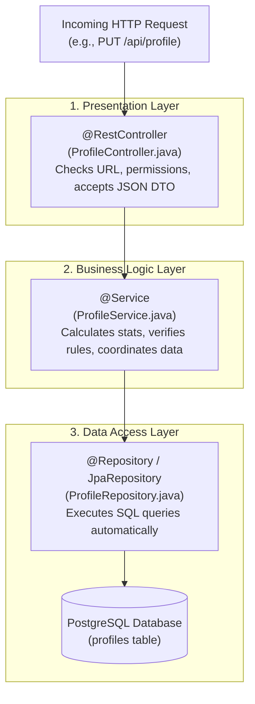

# 📘 Book My Stars (BMS) - Developer Master Handbook
> *A Beginner-Friendly, End-to-End Guide to Understanding, Architecting, and Modifying the Book My Stars Application.*

---

## 🎯 Welcome! Who This Guide Is For
If you are completely new to software development, this handbook is created specifically for you. By the time you finish reading this, you will:
1. Understand how web applications work under the hood.
2. Understand the exact role of **React** (Frontend), **Spring Boot** (Backend), and **PostgreSQL** (Database).
3. Know what every folder, class, and component in this project does.
4. Know how data travels when a user clicks a button.
5. Be able to open **VS Code**, locate any file, understand what it is doing, and make changes yourself.

---

## Table of Contents
1. [Module 1: The Big Picture (The Restaurant Kitchen Analogy)](#module-1-the-big-picture-the-restaurant-kitchen-analogy)
2. [Module 2: Core React Concepts (The Frontend Engine)](#module-2-core-react-concepts-the-frontend-engine)
3. [Module 3: Core Java & Spring Boot Concepts (The Backend Engine)](#module-3-core-java--spring-boot-concepts-the-backend-engine)
4. [Module 4: Complete Directory & Class-by-Class Tour](#module-4-complete-directory--class-by-class-tour)
5. [Module 5: Follow the Data (Step-by-Step Life of a Request)](#module-5-follow-the-data-step-by-step-life-of-a-request)
6. [Module 6: How to Make Changes on Your Own (Developer Recipes)](#module-6-how-to-make-changes-on-your-own-developer-recipes)

---

# Module 1: The Big Picture (The Restaurant Kitchen Analogy)

Every modern web application is just like a **fine-dining restaurant**:

```mermaid
flowchart LR
    User["👤 Customer\n(Browser / App)"] 
    Frontend["📋 Waiter & Menu\n(React Frontend)"]
    Network["🛎️ Order Ticket\n(HTTP Request / JSON)"]
    Backend["👨‍🍳 Head Chef & Kitchen\n(Spring Boot Backend)"]
    Database["🥫 Pantry Vault\n(PostgreSQL Database)"]

    User -->|Clicks or Types| Frontend
    Frontend -->|Sends HTTP Request| Network
    Network -->|Delivers to Controller| Backend
    Backend -->|Queries / Saves Data| Database
    Database -->|Raw Records| Backend
    Backend -->|Formats JSON Envelope| Network
    Network -->|HTTP Response| Frontend
    Frontend -->|Renders Visual UI & Alerts| User
```



### The Roles Explained in Plain English:
1. **The Customer (`The User`)**: A person sitting at their laptop or phone using a web browser like Chrome.
2. **The Waiter & The Menu (`The Frontend - React`)**:
   - The customer never touches the hot ovens or pantry directly. They only look at the pretty menu (buttons, cards, inputs) and speak to the waiter.
   - When the customer clicks *"Save Profile"*, the waiter (React + Axios) writes down the details on an order slip and runs it to the kitchen.
3. **The Order Slip (`HTTP Request / JSON`)**:
   - Computers don't speak English. They exchange structured text messages called **JSON** (JavaScript Object Notation), which looks like key-value pairs:
     ```json
     {
       "fullName": "Ayush MK",
       "location": "Bangalore",
       "about": "Lead Actor and Model"
     }
     ```
4. **The Head Chef & Kitchen Staff (`The Backend - Spring Boot`)**:
   - The kitchen receives the order slip.
   - The **Head Chef (`Controller`)** checks the order: *"Is this table valid? Do they have a VIP badge (`JWT Token`)?"*
   - The **Specialist Cooks (`Service`)** prepare the food: calculate stats, hash passwords, verify rules.
5. **The Pantry & Storage Vault (`The Database - PostgreSQL`)**:
   - The place where ingredients and long-term records are locked safely in organized tables (`users`, `profiles`, `work_experiences`).
   - The **Pantry Keeper (`Repository`)** goes into the vault to fetch or store data.

---

# Module 2: Core React Concepts (The Frontend Engine)

The frontend is located in the **`frontend/`** folder. It is built using **React 18** and **Vite**.

### 1. What is a "Component"?
Think of a component like a **Lego brick**. Instead of writing one giant 10,000-line HTML file, we break the webpage into reusable bricks:
- `About.jsx` = The About card brick.
- `OverviewTab.jsx` = The dashboard tab brick.
- `CropPhotoModal.jsx` = The popup window for cropping pictures.

In React, a component is just a JavaScript function that returns visual markup called **JSX**:
```jsx
// A simple React Lego brick
export default function WelcomeCard({ name }) {
  return (
    <div className="card">
      <h2>Welcome back, {name}!</h2>
    </div>
  );
}
```

### 2. What is `useState`? (The Component's Memory)
Normal JavaScript variables reset when a screen redraws. `useState` is a **persistent whiteboard** inside a component. Whenever you update it, React automatically re-draws the screen with the new value.

```jsx
// count is the current number, setCount is the only way to change it
const [count, setCount] = useState(0);

// When a button is clicked:
<button onClick={() => setCount(count + 1)}>Add Project</button>
```

### 3. What is `useEffect`? (The Automatic Sensor / Side-Effect)
`useEffect` tells React: *"Run this piece of code automatically when the page first opens, or whenever a specific variable changes."*
```jsx
useEffect(() => {
  // This runs immediately when the user opens their Profile page!
  fetchProfileDataFromBackend();
}, []); // Empty brackets [] mean: "Run once when loaded"
```

### 4. What is `Axios`? (The Delivery Messenger)
Axios is a library that makes HTTP calls (`GET`, `POST`, `PUT`, `DELETE`) over the internet to our backend.
In this project, all Axios calls go through:
- **`src/shared/services/axiosConfig.js`**: Automatically attaches your secret login token (`Authorization: Bearer <TOKEN>`) to every outgoing request.

### 5. What is `SweetAlert2` (`alert.js`)?
Instead of using the browser's default grey popups (`alert("Saved")`), we use SweetAlert2:
- `showSuccess("Saved!", "Your profile is updated.")` ➔ Beautiful green checkmark modal.
- `showError("Failed", "Please check your network.")` ➔ Modern red error dialog.
- `confirmDelete("Delete this work experience?")` ➔ Confirmation dialog asking *"Are you sure?"* before deleting.

---

# Module 3: Core Java & Spring Boot Concepts (The Backend Engine)

The backend is located in the **`backend/`** folder. It is built using **Java 17+** and **Spring Boot 3**.

### 1. The 3-Tier Enterprise Architecture
Spring Boot strictly divides responsibilities into 3 distinct layers so that code never gets messy:



### 2. What are "Annotations" (The `@` Words)?
In Java, words starting with `@` are instructions to Spring Boot. Think of them as badges you pin onto a class:
- **`@RestController`**: *"Spring, this class listens to web requests from the internet."*
- **`@GetMapping("/profile")`**: *"Run this function when someone visits this URL to read data."*
- **`@PutMapping("/profile")`**: *"Run this function when someone sends updated data."*
- **`@Service`**: *"Spring, this class contains the business logic calculations."*
- **`@Entity`**: *"This Java class directly matches a table in PostgreSQL."*
- **`@Id` & `@GeneratedValue`**: *"This field is the Primary Key (ID) of the database table."*
- **`@RequiredArgsConstructor` (Lombok)**: Automatically creates a constructor and links required classes together (called **Dependency Injection**).

### 3. What is a "DTO" (Data Transfer Object)?
We never expose raw database tables directly to the public internet for security and efficiency.
Instead, we use **DTOs** as safe envelopes:
- **`ProfileUpdateRequest.java`**: The envelope the frontend sends TO the backend when editing profile.
- **`ProfileResponse.java`**: The envelope the backend sends BACK to the frontend with cleaned-up profile data.
- **`ClientResponseBean.java`**: The company standard wrapper envelope that wraps every response with status code, message, and timestamp.

### 4. What is JWT (JSON Web Token)?
When a user logs in with email and password:
1. `AuthService` verifies the credentials.
2. If valid, the backend generates an encrypted string called a **JWT Token**.
3. The frontend stores this token in `localStorage`.
4. Every time the frontend asks for data (like *"Get my private portfolio"*), it includes this token.
5. `JwtAuthenticationFilter.java` reads the token, identifies who you are, and allows access.

---

# Module 4: Complete Directory & Class-by-Class Tour

## A. Backend Tour (`backend/src/main/java/com/example/bookmystars/`)

### 1. Root & App Entry Point
- **`BookmystarsApplication.java`**: The main ignition switch of the backend (`public static void main`). Running this starts Tomcat on port `8080`.
- **`app/AppCommandLineRunner.java`**: Code that runs right after startup (used for initial database seeding or health checks).

### 2. `model/` (The Database Entities)
Each file here represents an actual table in PostgreSQL:
- **`User.java`**: The `users` table. Stores `email`, `password` (BCrypt encrypted), `fullName`, `accountType` (`TALENT` vs `PROFESSIONAL`), and phone number.
- **`Profile.java`**: The `profiles` table. Connected 1-to-1 with `User`. Stores `about`, `yearsExperience`, `projectsCompleted`, `brandsWorked`, `magazineFeatures`, and `profilePhoto`.
- **`WorkExperience.java`**: The `work_experiences` table. Stores company, title, start date, end date, and attached document proof URL.
- **`Portfolio.java`**: Stores uploaded portfolio photos, category (Runway, Editorial), and timestamps.
- **`Video.java`**: Stores video titles, category (Showreel, Monologue), and video URLs.
- **`Measurement.java`**: Stores height, bust, waist, hips, shoe size, eye color, and hair color.
- **`ProfileAccessRequest.java`**: Manages Instagram-style private profile view requests (`PENDING`, `APPROVED`, `REJECTED`).

### 3. `repository/` (The Database Accessors)
These interfaces extend `JpaRepository<Entity, ID>`. You don't have to write raw SQL (`SELECT * FROM ...`)! Spring Data generates the SQL automatically:
- **`UserRepository.java`**: Has built-in methods like `findByEmail(String email)`.
- **`ProfileRepository.java`**: Has `findByUser(User user)`.
- **`WorkExperienceRepository.java`**: Has `findByUser(User user)`.

### 4. `restcontroller/` (The Front Desks)
- **`AuthController.java`**: Handles `/api/auth/register` and `/api/auth/login`.
- **`ProfileController.java`**: Handles:
  - `GET /api/profile`: Returns the authenticated user's profile.
  - `PUT /api/profile`: Updates name, bio, craft, and career stats.
  - `POST /api/profile/photo`: Accepts file uploads and updates the avatar.
  - `PATCH /api/profile/privacy`: Toggles public vs. private mode.
- **`WorkExperienceController.java`**: CRUD for work experience entries and attachment uploads (`/api/work-experience`).
- **`PortfolioController.java` & `VideoController.java`**: Media uploads and management.

### 5. `service/` (The Brain of the Application)
- **`ProfileService.java`**: Fetches user data, updates profile details, and generates social sharing links.
- **`WorkExperienceService.java`**: Saves work history and automatically synchronizes the user's `projectsCompleted`, `brandsWorked`, and `yearsExperience` directly in the database.
- **`LoginService.java` & `RegistrationService.java`**: Validates credentials and hashes passwords using BCrypt.

### 6. `exception/` (The Centralized Safety Net)
- **`GlobalExceptionHandler.java`**: Catches errors from any controller and formats them into a clean JSON response instead of crashing with a messy stack trace.
- **`ClientResponseBean.java`**: Formats all output into the company-standard format:
  ```json
  {
    "status": 200,
    "message": "Profile updated successfully",
    "data": { ... }
  }
  ```

---

## B. Frontend Tour (`frontend/src/`)

### 1. Shared Infrastructure (`src/shared/` & `src/services/`)
- **`shared/services/BaseUrl.js`**: Stores the backend server address (`http://localhost:8080/api`).
- **`shared/services/axiosConfig.js`**: Configures Axios with interceptors to automatically pass the JWT authentication header.
- **`shared/utils/alert.js`**: Helper functions for SweetAlert2 (`showSuccess`, `showError`, `confirmDelete`, `showWarning`).
- **`services/api.js`**: The central library of functions that components call, such as `getCurrentUserProfile()`, `updateUserProfile()`, `addWorkExperience()`, etc.

### 2. Profile Page Components (`src/pages/Profile/`)
- **`Profile.jsx`**: The main page container. Holds state for the user's profile, active tab, experiences, portfolio, and privacy settings.
- **`OverviewTab.jsx`**: The primary dashboard tab displaying:
  - The **About** card with auto-synced stats.
  - The **Portfolio Highlights** preview carousel.
  - The **Measurements** silhouette card.
  - The **Work Experience** and **Videos** summary cards.
- **`About.jsx`**: The card component that automatically calculates and displays:
  - *Projects Completed* (`experiences.length`)
  - *Brands Worked* (unique brand names count)
  - *Years Experience* (date span calculation)
  - *Features* (portfolio highlights + videos count)
  - Auto-generated or custom bio text.
- **`ProfileTabs.jsx`**: Contains full management sub-tabs for **Work Experience**, **Portfolio Photos**, **Videos**, **Measurements**, and **Rates**.
- **`CropPhotoModal.jsx`**: Provides an interactive image cropping tool before uploading avatar photos.

---

# Module 5: Follow the Data (Step-by-Step Life of a Request)

To truly think like a developer, let's trace exactly what happens when you perform an action:

### Scenario: Adding a New Work Experience

```text
[STEP 1: User Action in Browser]
User enters "Netflix", "Lead Actor", "2024" in WorkExperienceTab and clicks "Add Experience".
       │
       ▼
[STEP 2: React Component Event]
React triggers `handleAddWorkExperience()`.
Validation checks verify required fields.
       │
       ▼
[STEP 3: Axios API Call]
`api.js` calls `apiClient.post("/work-experience", workData)`.
`axiosConfig.js` automatically attaches: `Authorization: Bearer <TOKEN>`.
       │
       ▼
[STEP 4: Network Travel]
HTTP POST request arrives at Tomcat port 8080.
       │
       ▼
[STEP 5: Spring Security & Controller]
`JwtAuthenticationFilter` decrypts token ➔ extracts user email ("user@example.com").
Request arrives at `WorkExperienceController.java` (`@PostMapping`).
       │
       ▼
[STEP 6: Service Layer Execution]
`WorkExperienceService.java` creates a `WorkExperience` entity.
Calls `workExperienceRepository.save(workExperience)`.
PostgreSQL saves the new row in `work_experiences` table.
       │
       ▼
[STEP 7: Auto-Sync Stats]
`WorkExperienceService.syncProfileStats(user)` automatically runs:
Recounts all user projects and unique brands in PostgreSQL.
Updates `projectsCompleted` and `brandsWorked` in the `profiles` table!
       │
       ▼
[STEP 8: Response Returns to Browser]
Controller returns HTTP 200 with saved `WorkExperienceResponse` wrapped in `ClientResponseBean`.
       │
       ▼
[STEP 9: React State Update & Visual Feedback]
`Profile.jsx` receives the response.
Calls `showSuccess("Added!", "Work experience added successfully.")` (SweetAlert).
Calls `reloadExperiences()`, which refreshes local state.
`About.jsx` instantly re-renders: "Projects Completed" counter moves from 2 ➔ 3!
```

---

# Module 6: How to Make Changes on Your Own (Developer Recipes)

Here are practical step-by-step recipes you can use to add new features or modify existing ones:

### Recipe 1: How to Add a New Field (e.g. `instagramHandle`)

Suppose your manager asks: *"Please add an Instagram handle field to talent profiles."*

1. **Database / Model (`backend/src/.../model/Profile.java`)**:
   Add the field to the Java entity:
   ```java
   private String instagramHandle;
   ```
2. **DTOs (`backend/src/.../dto/`)**:
   - In `ProfileUpdateRequest.java`, add `private String instagramHandle;`.
   - In `ProfileResponse.java`, add `private String instagramHandle;`.
3. **Service (`backend/src/.../service/ProfileService.java`)**:
   In `updateProfile()`, add:
   ```java
   if (request.getInstagramHandle() != null) {
       profile.setInstagramHandle(request.getInstagramHandle().trim());
   }
   ```
   In `buildProfileResponse()`, add:
   ```java
   .instagramHandle(profile.getInstagramHandle())
   ```
4. **Frontend Form (`frontend/src/pages/Profile/Profile.jsx`)**:
   In `EditProfileModal`, add an input field:
   ```jsx
   <label>Instagram Handle</label>
   <input
     type="text"
     value={form.instagramHandle || ""}
     onChange={(e) => setForm({ ...form, instagramHandle: e.target.value })}
     placeholder="@username"
   />
   ```
5. **Compile & Push**:
   - Run `.\mvnw.cmd compile` in `backend/`.
   - Run `npm run build` in `frontend/`.
   - Push to Git using `git add .`, `git commit -m "feat: added instagram handle"`, `git push`.

---

### Recipe 2: How to Debug When Something Doesn't Work

Whenever you face an issue, use the **3-Point Debugging Method**:

1. **Point 1: Check the Browser Console & Network Tab**
   - Press `F12` in Chrome/Edge ➔ Click **Console** to see any red JavaScript errors.
   - Click the **Network** tab ➔ Click **Fetch/XHR**. When you click a button, look at the request:
     - `200 / 201` = Success.
     - `400` = Bad data sent from frontend (check request payload).
     - `401 / 403` = Authentication issue (token expired, log in again).
     - `404` = URL path is wrong.
     - `500` = Backend server crashed (check backend terminal).
2. **Point 2: Check the Spring Boot Terminal**
   - Look at the terminal running `mvnw spring-boot:run`. When a 500 error occurs, Spring Boot prints the exact file and line number where the error happened.
3. **Point 3: Check PostgreSQL Database**
   - Open pgAdmin or DBeaver to verify whether rows were actually saved in the database tables.

---

### Quick Glossary of Terms
- **API**: Application Programming Interface — a way for frontend and backend to talk to each other over HTTP.
- **Endpoint**: A specific URL on the backend (e.g., `GET /api/profile`).
- **Payload**: The data being sent inside an HTTP request or response.
- **State**: Data stored inside a React component that can change over time.
- **Props**: Data passed down from a parent React component to a child component.
- **Entity**: A Java class mapped directly to a database table.
- **Repository**: A Java interface responsible for saving and retrieving entities from the database.
