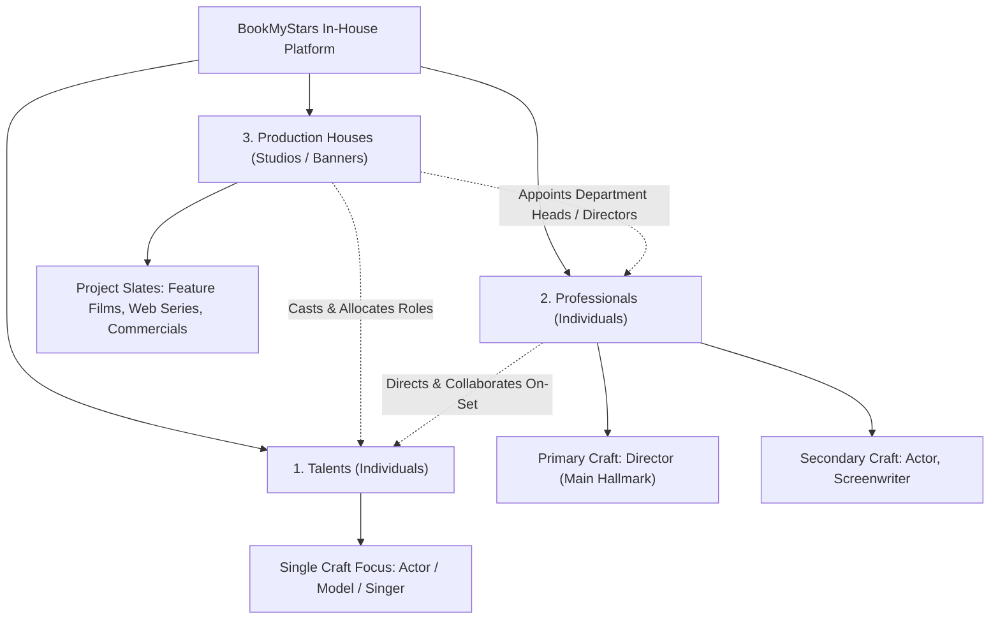
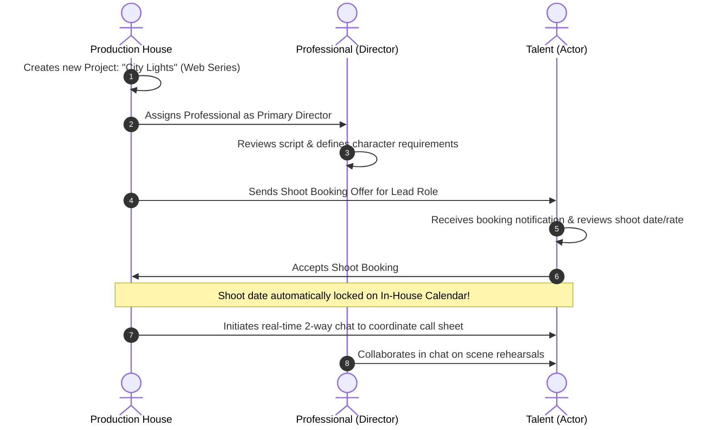

# Product Specification: 3-Pillar In-House Ecosystem Architecture
### (Talent &bull; Professional &bull; Production House)

**Document Version:** 2.0  
**Status:** Updated for Stakeholder Sign-Off  
**Audience:** Project Lead / Stakeholders / Engineering Team  

---

## 1. Executive Summary

This specification outlines the evolution of **BookMyStars** into an **Integrated 3-Pillar In-House Production Ecosystem**.

Rather than an open transactional gig marketplace, the platform serves as an enterprise-grade internal studio operating system where **all three categories are registered members and collaborative users**:

1. **🌟 Talent (Individual Specialist)**: Single-skill artists focused exclusively on one craft (e.g., pure *Actor*, *Model*, or *Dancer*).
2. **🎬 Professional (Multi-Skill Veteran)**: Experienced industry veterans who possess a **Primary Skill** (e.g., *Director*) and **Secondary Skills** (e.g., *Actor*, *Screenwriter* — the *Upendra model*).
3. **🏢 Production House (Studio Entity)**: Internal production banners, studios, and agencies who own the project slates (films, web series, ad campaigns) and assign, schedule, and book both Talents and Professionals.



---

## 2. In-Depth Explanation of the 3-Pillar Architecture

The diagram above illustrates how the three pillars coexist and collaborate inside the studio ecosystem:

### Pillar 1: The Talents (Single-Skill Artists)
* **Who they are**: Aspiring or focused performers dedicated to mastering **one single craft** (e.g., strictly an Actor, strictly a Fashion Model, or strictly a Classical Dancer).
* **Their role in the ecosystem**: They receive shoot offers, auditions, and role allocations from Production Houses and Directors, manage their availability on the calendar, and showcase their specialized showreels.

### Pillar 2: The Professionals (Multi-Skill Veterans)
* **Who they are**: Experienced industry leaders who wear multiple creative hats.
* **The "Upendra" Analogy**:  
  In the film industry, a veteran like **Real Star Upendra** is primarily known for **Direction** as his hallmark craft, but is equally renowned as a lead **Actor**, **Screenwriter**, and **Lyricist**.  
* **Their role in the ecosystem**: They can be attached to a project by a Production House to lead a department (e.g., as the Director), but can also be cast as an Actor or consulted as a Screenwriter.

### Pillar 3: The Production Houses (Studio Banners & Project Owners)
* **Who they are**: The production companies, studio banners, and internal production units (e.g., Hombale Films, Mythri Movie Makers, internal corporate production arms).
* **Their role in the ecosystem**: They are the **project generators**. They create the film or campaign slates, assemble the creative team by hiring Professionals (Directors, Cinematographers), cast Talents for character roles, allocate budgets, and issue official shoot dates.

---

## 3. Pillar Comparison Matrix

| Dimension | 🌟 Talent | 🎬 Professional | 🏢 Production House |
| :--- | :--- | :--- | :--- |
| **Entity Type** | Individual Artist | Individual Veteran | Corporate Studio / Banner |
| **Skill Structure** | **Strictly 1 Single Skill** | **1 Primary + Multiple Secondary Skills** | **Project & Production Governance** |
| **Primary Hallmark** | Craft mastery (e.g., Acting) | Leadership craft (e.g., Direction) | Brand & Film Slate (e.g., Movie titles) |
| **Key Platform Actions** | Upload headshots, accept shoot calls, chat | Lead projects, showcase multi-craft reels, cast | Create projects, allocate roster, issue bookings |
| **Navigation Presence** | Dedicated `[Talents]` Roster Tab | Dedicated `[Professionals]` Roster Tab | Dedicated `[Production Houses]` Studio Tab |

---

## 4. Platform Tab & Navigation Layout

The discovery and roster directory is divided into **three dedicated top-level tabs**:

```
┌────────────────────────────────────────────────────────────────────────┐
│  [🌟 Talents (128)]   |   [🎬 Professionals (45)]   |   [🏢 Production Houses (12)] │
└────────────────────────────────────────────────────────────────────────┘
```

### Tab 1: `[🌟 Talents]` Tab
* Displays single-craft artist cards with category filters (*Actors*, *Models*, *Singers*, *Dancers*).
* Shows verified attributes (age, location, languages, rate) and availability.
* Direct action: `[Request Shoot Booking]` or `[Request Portfolio Access]`.

### Tab 2: `[🎬 Professionals]` Tab
* Displays multi-skilled veteran cards.
* Shows **Primary Craft Badge** (e.g., `Director`) + **Secondary Skill Pills** (e.g., `+ Actor`, `+ Screenwriter`).
* Cross-craft filtering: Filtering for an *"Actor"* surfaces both Acting Talents **and** Professionals with Acting as a secondary craft.

### Tab 3: `[🏢 Production Houses]` Tab (New Dedicated Tab)
* Displays registered Production Studios and Banners.
* Shows studio banner, ongoing film/series slates, recent theatrical/OTT releases, and active shoot locations.
* Clicking into a Production House reveals:
  * **Active Project Slates** (e.g., *"Title: Operation Red"* — Feature Film — In Casting).
  * **Current Creative Team** (Associated Directors & Cast).
  * **Direct Studio Contact & Collaboration Channel**.

---

## 5. End-to-End Collaboration Workflow



---

## 6. Technical Architecture & Database Impact

### 6.1 Database Schema Additions
1. **`AccountType` Enum**: Extended to support `TALENT`, `PROFESSIONAL`, and `PRODUCTION_HOUSE`.
2. **`ProductionHouse` Entity**:
   * `id`: Primary key
   * `userId`: Linked user account
   * `companyName`: Banner name (e.g., "Silver Screen Productions")
   * `bannerLogoUrl`: Studio emblem
   * `activeProjectsCount`: Integer
   * `headquarters`: City / State
   * `description`: Bio / Production scope
3. **`Profile` Entity**:
   * `primarySkill`: String (e.g., "Director")
   * `secondarySkills`: List/Set of Strings (e.g., ["Actor", "Screenwriter"])
   * `accountType`: Enum value

---

## 7. Leadership Sign-Off Checklist

Please present this checklist to the project lead for final validation:

* [ ] **3-Pillar Taxonomy Approved**: Talent (single-skill), Professional (multi-skill), Production House (studio).
* [ ] **Dedicated Navigation**: Three separate tabs for Talents, Professionals, and Production Houses.
* [ ] **Hierarchical Skills for Professionals**: Primary craft + secondary auxiliary crafts (Upendra model).
* [ ] **In-House Studio Scope**: All 3 pillars operate as collaborative internal users of the same system.

---
*Prepared by the Engineering & Architecture Pair Programming Team for BookMyStars.*
